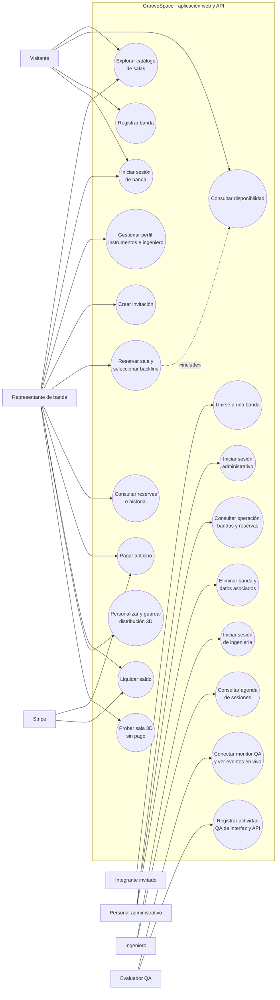
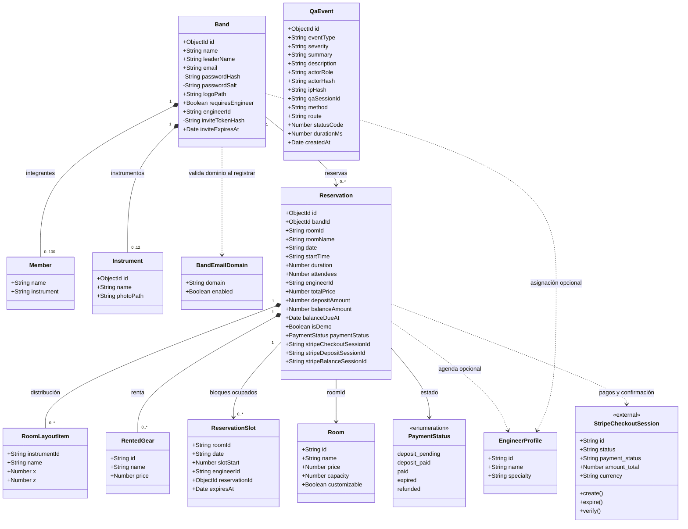
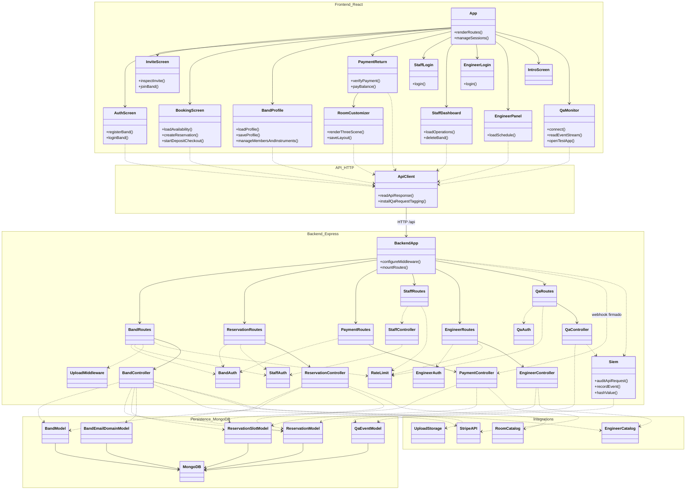

# Diagramas UML de GrooveSpace

Los diagramas describen el sistema implementado en `groovespace-frontend` y
`groovespace-backend`. Se pueden visualizar en visores compatibles con Mermaid.

## Diagrama de casos de uso

El límite del sistema incluye la aplicación web y su API. Stripe es un sistema
externo; la invitación permite que un integrante se una sin iniciar sesión.

## Diagrama de clases del dominio

`Member`, `Instrument` y `RentedGear` representan subdocumentos embebidos en
MongoDB; `Room` y `EngineerProfile` provienen de configuración estática, no de
colecciones. `ReservationSlot` materializa los bloques de 15 minutos usados
para evitar traslapes.

## Diagrama de clases de la arquitectura

Las flechas de dependencia muestran el flujo principal: pantallas React usan el
cliente HTTP; las rutas Express aplican autenticación antes de delegar en
controladores, que operan sobre modelos Mongoose o integraciones externas.

### Alcance y reglas representadas

- Los pagos reales usan Stripe Checkout; el backend confirma el resultado por
  verificación de sesión o webhook firmado. El navegador no confirma por sí solo
  un pago.
- Una reserva bloquea intervalos de sala y, si aplica, del ingeniero. Los
  intervalos pendientes expiran; un anticipo confirmado conserva los bloques.
- La personalización 3D está disponible para salas configurables cuando la
  reserva ya tiene anticipo confirmado o se creó como demostración de desarrollo.
- El monitor QA está deshabilitado en producción. Los eventos persistidos tienen
  retención TTL de 30 días.
